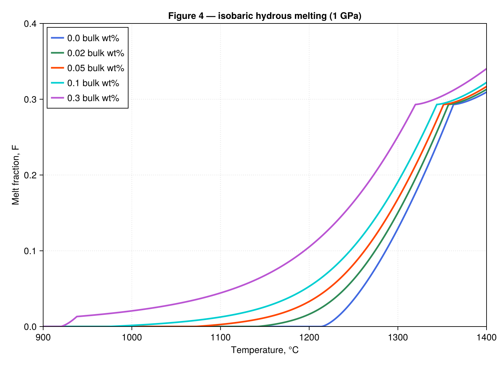

# JustMelt.jl

Dry and hydrous equilibrium mantle melting in Julia, following [Katz, Spiegelman & Langmuir (2003)](https://doi.org/10.1029/2002GC000433), *A new parameterization of hydrous mantle melting*.

The model includes pressure-dependent phase boundaries, clinopyroxene exhaustion, water partitioning and saturation, and an implicit wet-melting solver. Scalar calculations support Float32 and Float64. Metal.jl kernel usage is documented; GPU execution has not yet been verified.

## Installation

The package is not registered. Install it from GitHub:

```julia
using Pkg
Pkg.add(url="https://github.com/albert-de-montserrat/JustMelt.jl")
```

For development or figure reproduction:

```sh
git clone https://github.com/albert-de-montserrat/JustMelt.jl.git
cd JustMelt.jl
julia --project=. -e 'using Pkg; Pkg.instantiate()'
```

## Quick start

```julia
using JustMelt

# 1 GPa, 1300 °C, 15% initial clinopyroxene by mass.
F_dry = melt_fraction(1.0, 1300.0, 0.15, DryMeltingLaw())

# 1 GPa, 1200 °C, 17% initial clinopyroxene, 0.1 wt% bulk water.
F_wet = melt_fraction(1.0, 1200.0, 0.17, 0.1, WetMeltingLaw())

# Float32 throughout: use matching input and coefficient types.
law32 = WetMeltingLaw(Float32)
F32 = melt_fraction(1f0, 1200f0, 0.17f0, 0.1f0, law32)
@assert F32 isa Float32
```

`DryMeltingLaw`, `WetMeltingLaw` and `melt_fraction` are exported. Helper functions can be imported explicitly or accessed with the `JustMelt.` prefix. See the [API documentation](docs/api.md) for custom coefficients, solver options and residual derivatives.

## Units

| Quantity | Convention |
| --- | --- |
| Pressure | GPa |
| Temperature | °C; do not add 273.15 |
| Bulk and dissolved water | wt%: `0.1` means 0.1 wt%, or mass fraction 0.001 |
| Melt fraction `F` | Mass fraction between 0 and 1 |
| Initial modal clinopyroxene | Mass fraction: `0.17` means 17 wt% |

These functions describe closed-system equilibrium batch melting. They do not model melt extraction, adiabatic upwelling, or a subduction-zone thermal field.

## Float32 and Metal.jl

Float32 laws and inputs preserve Float32 constants, powers, solver brackets, tolerances and analytic residual derivatives. The default wet-solver tolerance is about `4.77f-7` for Float32 and `1e-12` for Float64.

For device kernels, use `check=Val(false)` to return a typed NaN on invalid input or nonconvergence without constructing exceptions:

```julia
F32 = melt_fraction(1f0, 1200f0, 0.17f0, 0.1f0, law32; check=Val(false))
```

The default checked API throws on invalid input and nonconvergence. Float32 CPU tests, allocation checks and LLVM inspection pass; these checks do not establish Metal device compatibility. See [Metal kernel examples and validation notes](docs/metal.md).

## Reproduce the paper's model curves

From the repository root:

```sh
julia --project=. figures/Katz_figs.jl --headless
```

This saves nine PNGs in `figures/`: Figures 1–6 and 8–10. Omit `--headless` for interactive GLMakie windows; that mode requires GLMakie installed separately and a display server. CairoMakie is included in the project dependencies.



Figures 2, 4 and 5 reproduce the model curves. Other outputs label partial coverage: experimental observations and alternative melting models are absent. Figures 7, 11 and 12 require additional data or physics. These are numerical reproductions rather than pixel-exact copies; see [figure coverage and assumptions](figures/figures-notes.md).

## Tests

```sh
julia --project=. -e 'using Pkg; Pkg.test()'
```

Or run the test entry point directly:

```sh
julia --project=. test/runtests.jl
```

The CPU suite covers coefficients and analytical branch values, cpx-out continuity, water mass balance and saturation, equilibrium residuals, monotonicity, zero-water reduction, solver failures, and analytic derivatives against finite differences and ForwardDiff. Float32 tests also check inference, agreement with Float64, allocations and inspected LLVM arithmetic. Metal hardware validation requires macOS and a functional GPU and is not part of the current CPU suite.

## Reference

Katz, R. F., Spiegelman, M., & Langmuir, C. H. (2003). A new parameterization of hydrous mantle melting. *Geochemistry, Geophysics, Geosystems*, 4(9), 1073. [doi:10.1029/2002GC000433](https://doi.org/10.1029/2002GC000433).
